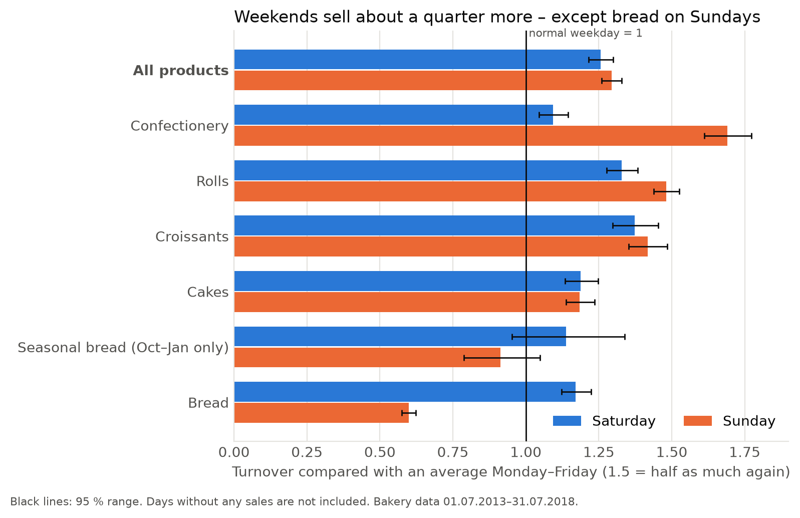

# Plan for busier weekends – but bake less bread on Sundays

**To:** Operations manager · **From:** Bakery project team · **Basis:** sales July 2013 – July 2018

**Recommendation:** Plan Saturdays and Sundays for about **a quarter more** sales than a normal weekday.
Put the extra into rolls, croissants and – on Sundays – confectionery, which rise the most.
At the same time, bake less bread on Sundays: bread sells about **40 % less** on a Sunday than on a weekday.

**How sure we are:** Very. The weekend pattern is not driven by a few busy weekends: **24 of every 25**
Saturdays and Sundays sold more than an average weekday of the same week. Only seasonal bread shows no
reliable weekend pattern, so plan it as on weekdays.

**What the data cannot tell us:** The figures show what was *sold*, not what was *baked* or thrown away.
If shelves already ran empty on busy weekends, real demand is even higher than shown – and the data
cannot tell us how much extra to bake. Comparing these figures with your production and waste lists
would close that gap.

**When this does not apply:** public holidays and other special days (for example Kiel Week) were not
looked at separately; plan those as before.
